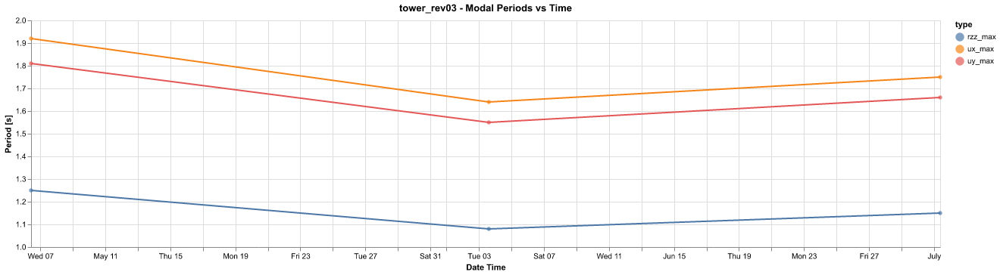
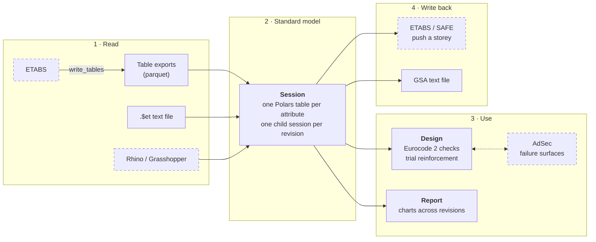
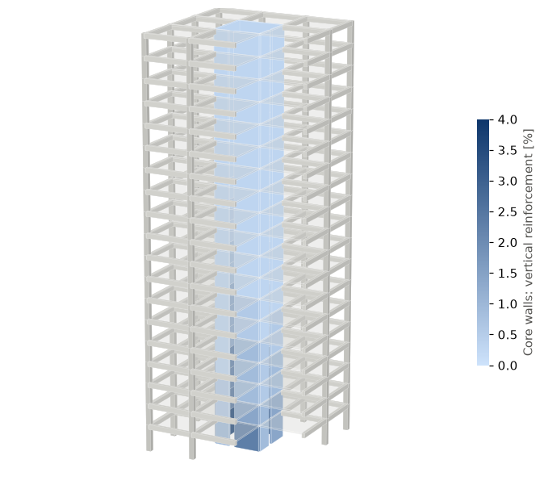
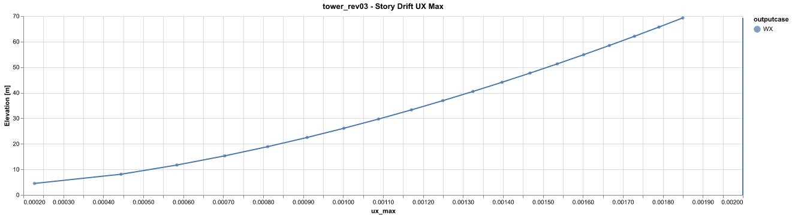
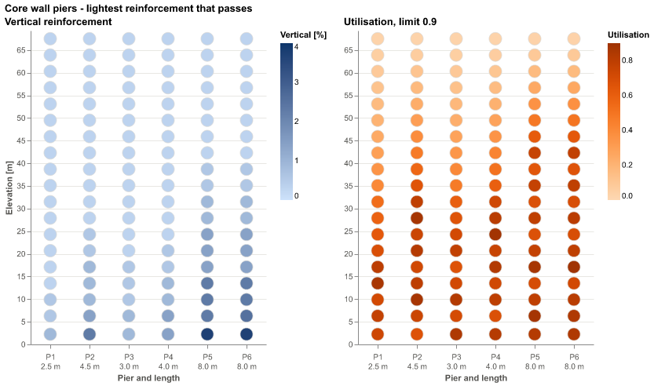
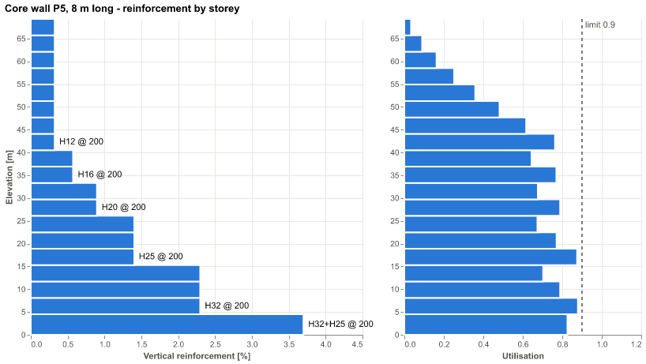

# steng-design-pipeline

[](https://github.com/hozhuyi-dev/steng-design-pipeline/actions/workflows/checks.yml)

A Python library for designing concrete buildings across the analysis software engineers already use. It reads ETABS models into one set of Polars DataFrames, pushes floors back to ETABS and SAFE, designs reinforced concrete columns, walls, coupling beams and piles to Eurocode 2, and tracks a model's results across its revisions.

I built it for, and used it on, high-rise towers in Malaysia. This is the library with the project code and data removed, and an example tower in their place.

<p align="center"></p>

## Why

A tower's structural design runs through several programs: ETABS for the building, SAFE for the foundations, AdSec for section capacities, GSA and Compos for steelwork. Each has its own API, units and table formats, and a model goes through dozens of revisions. The glue between them is usually a spreadsheet or a Grasshopper definition, and both get harder to trust as the project goes on: results are pasted in by hand, formulas hide in cells and wires, and nobody can say what changed since the last issue.

Writing that glue as a Python library instead means:

- **Every change is versioned.** A design check is plain text in git, so each change to it has a diff, a date and a reason, and can be reviewed before it's used. An Excel workbook or a `.gh` file can only be saved as copies, with no way to see what changed between them.
- **The same code runs in a script or in Grasshopper.** On its own, it reads models, designs members and draws charts with no CAD open, on any machine. Inside a Grasshopper Python component, the same `Session` takes geometry from Rhino with `from_rhino` and bakes it back with `to_rhino`. The engineering lives in one place rather than copied between a definition and a script.
- **A new revision is a rerun, not a redo.** When the model changes, the same script reads the new export and repeats every check and chart, and the results sit beside the earlier revisions for comparison.
- **The checks can be tested and audited.** Each Eurocode 2 expression is a function named for its clause, and the tests compare them to hand calculations on every commit. A formula dragged down the wrong rows in a spreadsheet fails silently.
- **It scales to the whole building.** Checking every pier at every storey under every load combination is one vectorised pass over a DataFrame, not a sheet of rows that takes minutes to recalculate.

This library puts one schema in the middle. Every source is converted into the same tables (`story`, `column`, `wall`, `story_drift`, `force_pier`, ...), so a design check or a chart is written once and works on any model and any revision.

## How it fits together



Dashed boxes are commercial programs, which are optional: everything else runs without them.

| Package | What it holds |
|---|---|
| [`steng.session`](src/steng/session.py) | `Session`: the standard model's schema, reading models and revisions, and joining them for comparison |
| [`steng.model`](src/steng/model) | Mixins that convert each source to and from the standard model: `.$et` parser, ETABS tables, Rhino, AdSec, and out to ETABS, SAFE and GSA text |
| [`steng.connectors`](src/steng/connectors) | Wrappers over the commercial APIs (.NET through pythonnet, COM through comtypes), loaded only when used |
| [`steng.design`](src/steng/design) | Eurocode 2 expressions, force-moment interaction curves, reinforcement layouts, utilisation checks, and `RcDesignMixin`, which designs columns, walls, coupling beams and piles |
| [`steng.geometry`](src/steng/geometry) | Section names and vectorised ray-triangle intersection, for checking design forces against a failure surface |
| [`steng.report`](src/steng/report) | `LogMixin`: charts that track a model across revisions; design charts; the model as 3D solids, written to STL |

Design choices:

- **DataFrames all the way through.** A design check is a function from a DataFrame to a DataFrame, validated with [pandera](https://pandera.readthedocs.io/) schemas, so thousands of members and load combinations are checked in one vectorised pass.
- **Revisions are data.** Each model export is a child session stamped with its date. A chart over `session.get_df("modal")` shows every revision at once.
- **Commercial software is optional.** The connectors load their .NET assemblies on first use, so everything else runs on any machine.

## Example

[`examples/`](examples) holds a made-up 18-storey tower in three revisions: rev02 thickens the core walls and rev03 adds a storey. Its 8 m core has doors in two walls, leaving six wall piers from 2.5 m to 8 m long. The scripts write it as ETABS would: `.$et` model files, and result tables exported to parquet, one folder per revision and purpose. The results come from a simple load model, not from an analysis.

<p align="center"><a href="examples/tower_rev03.stl"></a></p>
<p align="center"><sub>The latest revision, read from its <code>.$et</code> file into a <code>Session</code> and drawn with <a href="src/steng/report/model3d.py"><code>steng.report.model3d</code></a>, its core walls shaded by the design below. The frame is cut away at the near corner to show the core. Click it to turn the whole model in GitHub's 3D viewer.</sub></p>

```sh
uv sync
uv run python examples/render_charts.py
```

```python
from steng.session import Session

# Geometry from ETABS text files: one child session per revision
session = Session().read_models(["tower_rev01.$et", "tower_rev02.$et", "tower_rev03.$et"], abs_path="examples")
session.sessions["tower_rev01"].wall      # wall, story, pier, thickness, grade, xs, ys, zs, area, ...
session.get_df("wall")                    # every revision, with datetime and model columns

# Results from ETABS table exports, named <datetime>_<model>_<purpose>_etabs
results = Session().read_models([
    "20250506-101500_tower_rev01_log_etabs",
    "20250603-143000_tower_rev02_log_etabs",
    "20250701-091000_tower_rev03_log_etabs",
], abs_path="examples").create_latest_model()
results.log_story_drift_ux_max(["WX"], drift_limit=500)
```

<p align="center"></p>

## Design checks

`DesignSession` adds the design methods to a session. For walls and columns, each design:

1. Picks the members, stories and load combinations to check, by regular expression.
2. Lays out trial reinforcement over a grid of ratios, bar sizes and spacings.
3. Checks every trial with the Eurocode 2 simplified method: imperfections and second-order effects by nominal curvature (5.8.8), and biaxial bending (5.39). Then it adds shear reinforcement (6.2).
4. Optionally confirms the governing cases against AdSec's failure surface: each design force is a ray from the origin, and the utilisation is 1/t where it meets the surface.
5. Picks the lightest arrangement that passes.

Without AdSec, the design stops after the simplified check and picks from its utilisations. On the example tower's core walls:

```python
import numpy as np
from steng.design_session import DesignSession

walls = (
    DesignSession()
    .read_models(["20250701-091000_tower_rev03_rc-wall_etabs"], abs_path="examples")
    .create_rc_wall()
    .design_rc_wall(
        contain_outputcase="^ULS", ur_limit_pmm=0.9,
        perc_vert=np.array([0.4, 0.6, 0.8, 1.0, 1.5, 2.0, 2.5, 3.0, 4.0]),    # trial ratios [%]
        use_adsec=False,
    )
)
walls.get_rc_wall(0.9)    # per pier and storey: the bars chosen, their utilisation, the governing combination
```

The wind goes to the piers in proportion to their stiffness, so the long piers need the most steel at the base, and every pier is down to the minimum by mid-height:

<p align="center"></p>

Each pier's layout changes where a lighter one stops passing:

<p align="center"></p>

Coupling beams get flexural and shear reinforcement from the spandrel forces, and piles are checked against force-moment curves.

## Tests

```sh
uv run ruff check . && uv run pytest
```

The tests check the pure parts against hand calculations: Eurocode 2 expressions, the force-moment curve of a rectangular section against the rectangular stress block, the ray intersection against a plane-and-barycentric reference, the example tower read from both sources, and the design of its core walls and columns without AdSec, from the load model's forces through imperfections, slenderness and shear to the bars chosen.

## Installing

Python 3.10 or later, with [uv](https://docs.astral.sh/uv/):

```sh
uv sync                      # core: models, design, charts
uv sync --extra csi          # ETABS and SAFE, through pythonnet (Windows)
uv sync --extra adsec        # AdSec
```

The ETABS, SAFE, GSA, Compos and AdSec connectors need those programs installed and licensed. The Grasshopper helpers run inside Rhino.

## Limitations

- The `.$et` parser covers concrete rectangular frame sections and slab and wall shells, which is what the projects used.
- Pure compression on the force-moment curve takes the strain at ε<sub>cu2</sub> rather than ε<sub>c2</sub>, which slightly overstates the steel's share.
- The ETABS, SAFE and AdSec connectors aren't tested here, since they need the software.

## Licence

© Ho Zhu Yi. All rights reserved. Shared to show my work; please ask before reusing it.
