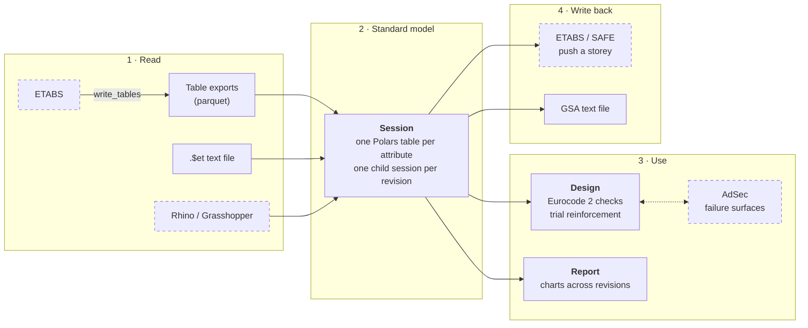

# steng-design-pipeline

[](https://github.com/hozhuyi-dev/steng-design-pipeline/actions/workflows/checks.yml)

A Python library for designing concrete buildings across the analysis software engineers already use. It reads ETABS models into one set of Polars DataFrames, pushes floors back to ETABS and SAFE, designs reinforced concrete columns, walls, coupling beams and piles to Eurocode 2, and tracks a model's results across its revisions.

I built it for, and used it on, high-rise towers in Malaysia. This is the library with the project code and data removed, and an example tower in their place.

<p align="center"></p>

## Why

A tower's structural design runs through several programs: ETABS for the building, SAFE for the foundations, AdSec for section capacities, GSA and Compos for steelwork. Each has its own API, units and table formats, and a model goes through dozens of revisions. Moving results between them by spreadsheet is slow and error-prone, and it's hard to see what changed between revisions.

This library puts one schema in the middle. Every source is converted into the same tables (`story`, `column`, `wall`, `story_drift`, `force_pier`, ...), so a design check or a chart is written once and works on any model and any revision.

## How it fits together



Dashed boxes are commercial programs, which are optional: everything else runs without them.

| Package | What it holds |
|---|---|
| [`steng.session`](src/steng/session.py) | `Session`: the standard model's schema, reading models and revisions, and joining them for comparison |
| [`steng.model`](src/steng/model) | Mixins that convert each source to and from the standard model: `.$et` parser, ETABS tables, Rhino, AdSec, and out to ETABS, SAFE and GSA text |
| [`steng.connectors`](src/steng/connectors) | Wrappers over the commercial APIs (.NET through pythonnet, COM through comtypes), loaded only when used |
| [`steng.design`](src/steng/design) | Eurocode 2 expressions, force-moment interaction curves, reinforcement layouts, utilisation checks, and `RcDesignMixin`, which designs columns, walls, coupling beams and piles |
| [`steng.geometry`](src/steng/geometry) | Section names and vectorised ray-triangle intersection, for checking design forces against a failure surface |
| [`steng.report`](src/steng/report) | `LogMixin`: charts that track a model across revisions |

Design choices:

- **DataFrames all the way through.** A design check is a function from a DataFrame to a DataFrame, validated with [pandera](https://pandera.readthedocs.io/) schemas, so thousands of members and load combinations are checked in one vectorised pass.
- **Revisions are data.** Each model export is a child session stamped with its date. A chart over `session.get_df("modal")` shows every revision at once.
- **Commercial software is optional.** The connectors load their .NET assemblies on first use, so everything else runs on any machine.

## Example

[`examples/`](examples) holds a made-up five-storey tower in three revisions: rev02 thickens the core walls and rev03 adds a storey. The scripts write it as ETABS would: `.$et` model files, and result tables exported to parquet. The results come from a simple load model, not from an analysis.

```sh
uv sync
uv run python examples/render_charts.py
```

```python
from steng.session import Session

# Geometry from ETABS text files: one child session per revision
session = Session().read_models(["tower_rev01.$et", "tower_rev02.$et", "tower_rev03.$et"], abs_path="examples")
session.sessions["tower_rev01"].wall      # wall, story, pier, thickness, grade, xs, ys, zs, area, ...
session.get_df("wall")                    # every revision, with datetime and model columns

# Results from ETABS table exports, named <datetime>_<model>_<purpose>_etabs
results = Session().read_models([
    "20250506-101500_tower_rev01_log_etabs",
    "20250603-143000_tower_rev02_log_etabs",
    "20250701-091000_tower_rev03_log_etabs",
], abs_path="examples").create_latest_model()
results.log_story_drift_ux_max(["WX"], drift_limit=500)
```

<p align="center"></p>

## Design checks

`DesignSession` adds the design methods to a session. For walls and columns, each design:

1. Picks the members, stories and load combinations to check, by regular expression.
2. Lays out trial reinforcement over a grid of ratios, bar sizes and spacings.
3. Checks every trial with the Eurocode 2 simplified method: imperfections and second-order effects by nominal curvature (5.8.8), and biaxial bending (5.39). Then it adds shear reinforcement (6.2).
4. Confirms the governing cases against AdSec's failure surface: each design force is a ray from the origin, and the utilisation is 1/t where it meets the surface.
5. Picks the lightest arrangement that passes.

Coupling beams get flexural and shear reinforcement from the spandrel forces, and piles are checked against force-moment curves.

## Tests

```sh
uv run ruff check . && uv run pytest
```

The tests check the pure parts against hand calculations: Eurocode 2 expressions, the force-moment curve of a rectangular section against the rectangular stress block, the ray intersection against a plane-and-barycentric reference, and the example tower read from both sources. Writing them found three formula errors, which are fixed here:

- The compression steel stress in a doubly reinforced beam was scaled by ε<sub>cu3</sub>/0.035 instead of /0.0035, so it came out 10× too low.
- Its tension steel area added the concrete force to the area without dividing by f<sub>yd</sub>.
- The creep factor φ<sub>RH</sub> used h<sub>0</sub><sup>0.3</sup> instead of the cube root (Annex B).

## Installing

Python 3.10 or later, with [uv](https://docs.astral.sh/uv/):

```sh
uv sync                      # core: models, design, charts
uv sync --extra csi          # ETABS and SAFE, through pythonnet (Windows)
uv sync --extra adsec        # AdSec
```

The ETABS, SAFE, GSA, Compos and AdSec connectors need those programs installed and licensed. The Grasshopper helpers run inside Rhino.

## Limitations

- Several functions come in copies for 1, 3, 5 or 6 bar layers (`calculate_pm_wall_3`, `_5`, `_6`). They should become one function over any number of layers.
- The `.$et` parser covers concrete rectangular frame sections and slab and wall shells, which is what the projects used.
- Pure compression on the force-moment curve takes the strain at ε<sub>cu2</sub> rather than ε<sub>c2</sub>, which slightly overstates the steel's share.
- The ETABS and SAFE connectors aren't tested here, since they need the software.

## Licence

© Ho Zhu Yi. All rights reserved. Shared to show my work; please ask before reusing it.
